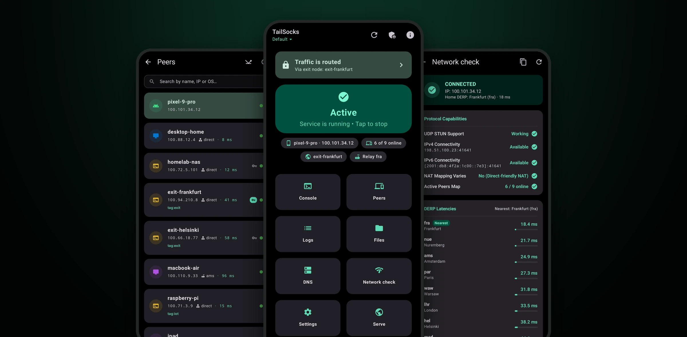
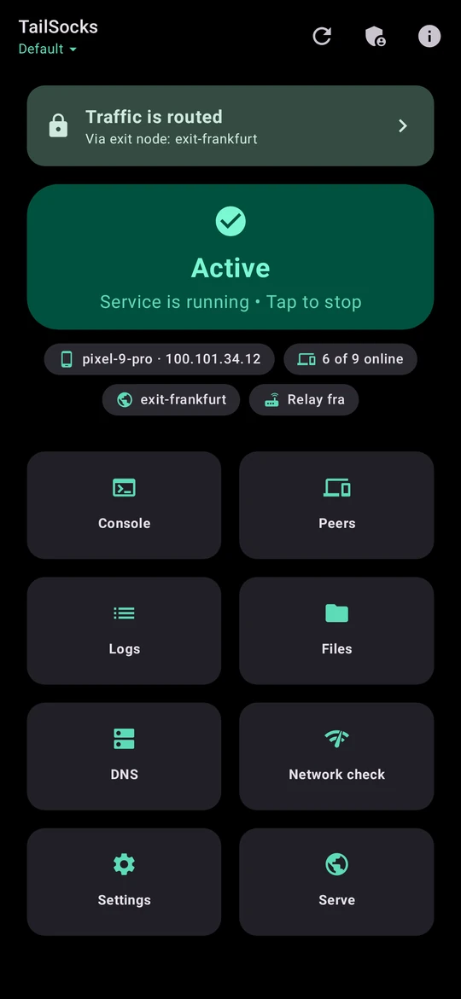
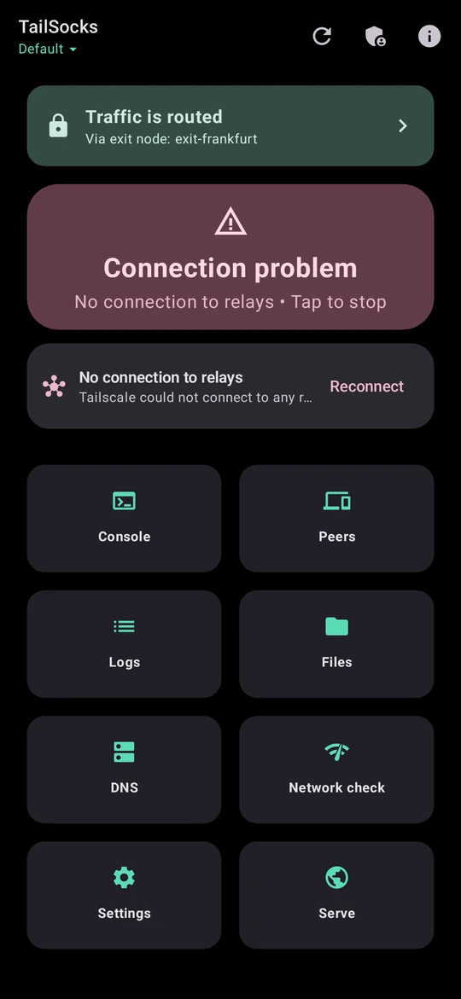
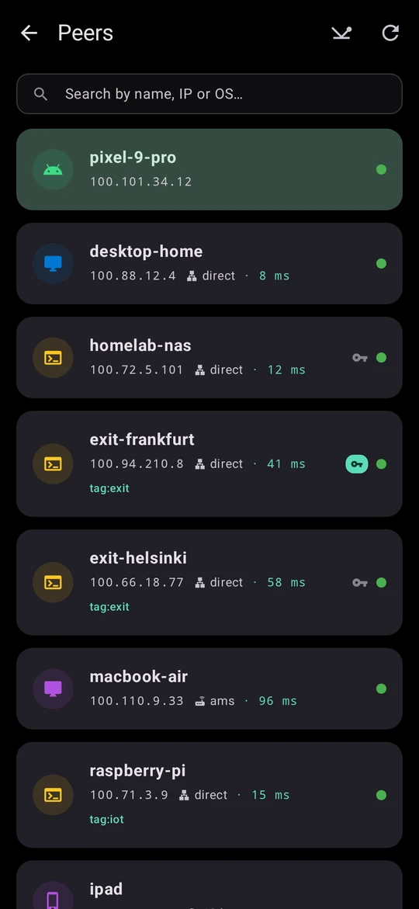
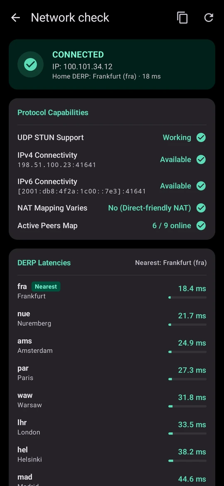
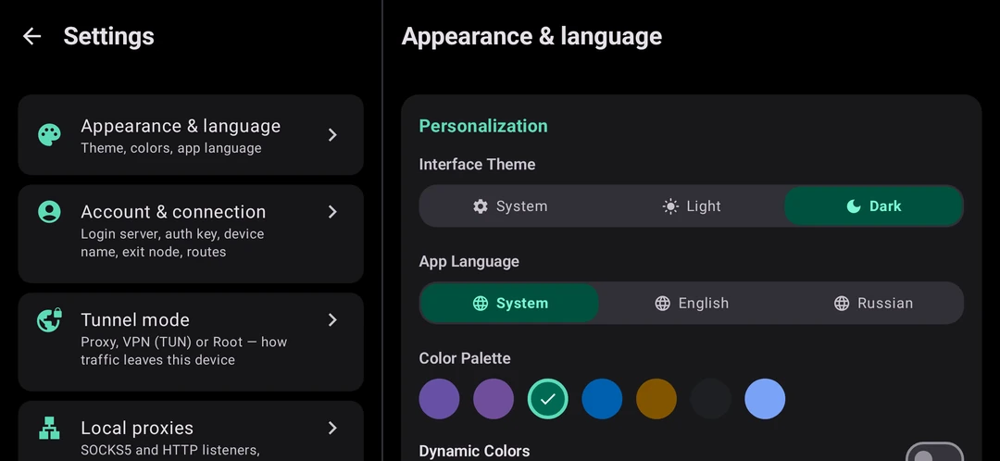
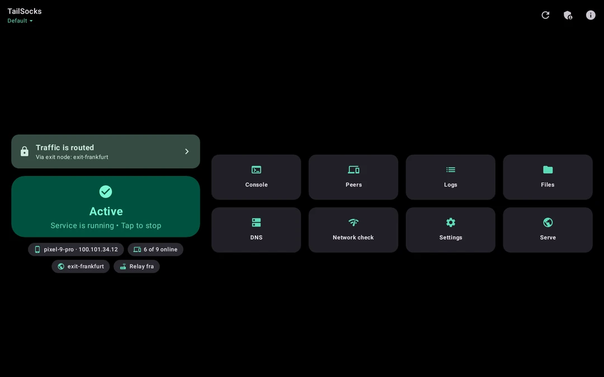

  

<h1 align="center">TailSocks</h1>

  <strong>Unofficial Tailscale client for Android — a proxy, a VPN, or root routing</strong>

  <strong>English</strong> | <a href="readme_ru.md">Русский</a>

<table align="center">
  <tr>
    <th>Release</th>
    <th>Downloads</th>
    <th>Tailscale core</th>
    <th>License</th>
    <th>Translated</th>
  </tr>
  <tr>
    <td align="center"></td>
    <td align="center"></td>
    <td align="center"></td>
    <td align="center"></td>
    <td align="center"></td>
  </tr>
</table>

<table align="center">
  <tr>
    <td align="center"></td>
    <td align="center"></td>
  </tr>
  <tr>
    <td align="center"></td>
    <td align="center"></td>
  </tr>
</table>

  

  <a href="https://bropines.github.io/tailsocks/"><strong>📖 The guide: bropines.github.io/tailsocks</strong></a> 
  Setup, connection modes, files, blocked networks, automation, troubleshooting

---

TailSocks runs a full [Tailscale](https://tailscale.com/) node on your Android phone (or, experimentally, Android TV) and lets you choose how it reaches the rest of the device: as a **local SOCKS5/HTTP proxy** that needs no VPN permission and coexists with any other VPN, as a **system-wide VPN** (TUN, split or full tunnel), or — on rooted devices — through a **real kernel interface** with policy routing. Everything Tailscale offers is there: [exit nodes](https://tailscale.com/kb/1103/exit-nodes), [MagicDNS](https://tailscale.com/kb/1081/magicdns), [Taildrop™](https://tailscale.com/kb/1106/taildrop), [Taildrive™](https://tailscale.com/kb/1369/taildrive), [Serve & Funnel](https://tailscale.com/kb/1242/tailscale-serve), several accounts, Headscale, and a built-in DPI bypass for the control plane where Tailscale is blocked.

It tells you what is actually going on: whether the tailnet is connected, still connecting or cut off from its relays, which of your devices are reachable directly and which only through a relay — and offers the one action that helps.

---

## ✨ Features

**Connecting** — [connection modes](https://bropines.github.io/tailsocks/connection-modes/)

- **Three modes:** a local SOCKS5/HTTP proxy that needs no VPN permission, a system-wide VPN (TUN), or Root Mode on a real `tailscale0` (experimental).
- **Exit nodes, MagicDNS, split DNS** and accepted subnet routes; the proxies can be opened to your Wi-Fi.
- **Blocked networks:** built-in ByeDPI, a control plane proxy, port 443 for the control connection, a start from the saved network map — [details](https://bropines.github.io/tailsocks/censorship/).

**Files and services**

- **Taildrop:** send from any app's Share menu, receive into a folder of your choice — [files](https://bropines.github.io/tailsocks/files/).
- **Taildrive:** share folders, browse other devices' shares, download them in a queue — several files at once — and play films with seeking.
- **Serve & Funnel** and Tailscale Services (`svc:`), with TLS certificate export.

**Managing**

- **Several accounts**, Headscale, and a main account that cannot be deleted.
- **Remote management (experimental):** manage another device's TailSocks over the tailnet after pairing with a code.
- **Admin console:** the Tailscale API — devices, DNS, users, keys, the policy — behind a biometric lock.
- **Automation:** token-protected broadcasts for Tasker, AppFunctions for assistants on Android 16+, `tailsocks://` links — [automation](https://bropines.github.io/tailsocks/automation/).
- **Backups:** full encrypted backups and per-account exports.

**Using it**

- **An honest main screen:** what is wrong, and the one action that helps.
- **Android TV (experimental):** the same APK, the whole app on a remote, sign-in by QR code.
- **Settings search** in English and Russian, forgiving typos and the wrong keyboard layout.
- **Material 3** themes and dynamic colour, two panes on tablets and foldables, widgets, a Quick Settings tile.
- **Translated** on [Hosted Weblate](https://hosted.weblate.org/engage/tailsocks/).

---

## 📸 Screenshots

<table>
  <tr>
    <td width="25%" align="center"> Connected, with a summary of the tailnet</td>
    <td width="25%" align="center"> What is wrong, and the one action that helps</td>
    <td width="25%" align="center"> Peers, pinged all at once</td>
    <td width="25%" align="center"> Home relay and DERP latencies</td>
  </tr>
  <tr>
    <td colspan="2" align="center"> Settings side by side on a wide screen</td>
    <td colspan="2" align="center"> Tablets and foldables get two panes</td>
  </tr>
</table>

Rendered from an invented tailnet by the app's own preview tests — see <a href="scripts/readme_shots.py"><code>scripts/readme_shots.py</code></a>.

---

## 🚀 Download

Grab the APK from [Releases](https://github.com/bropines/tailsocks/releases/latest), or add the repository to [Obtainium](https://apps.obtainium.imranr.dev/redirect?r=obtainium://add/https://github.com/bropines/tailsocks). The same APK installs on Android TV. First steps: [getting started](https://bropines.github.io/tailsocks/getting-started/).

Betas of the next version come out as GitHub pre-releases: the app offers them once *Receive beta versions* is on (Settings → Appearance & language), Obtainium once *Include prereleases* is on for it.

> **Supported architectures:** `arm64-v8a`, `armeabi-v7a`, `x86`, `x86_64`  
> **Minimum Android version:** 7.0 (API 24)

---

## 📚 Documentation

**Using TailSocks:** [bropines.github.io/tailsocks](https://bropines.github.io/tailsocks/).

**Developing it:** [Building](docs/BUILDING.md) · [Architecture](docs/ARCHITECTURE.md) · [Root guide](docs/ROOT.md) · [Serve & Funnel](docs/SERVE_FUNNEL_GUIDE.md) · [Contributing](CONTRIBUTING.md) · [Translating](docs/TRANSLATING.md) · [Roadmap](docs/ROADMAP.md) · [Changelog](CHANGELOG.md)

---

## 🤝 Credits & Acknowledgements

| | |
|-|-|
| **App & Patches** | [Bropines](https://github.com/bropines) — app development, architecture, and the majority of upstream patches |
| **Initial Android Patches** | [Asutorufa](https://github.com/Asutorufa) — original Android networking (`anet`) and network monitor (`netmon`) [patches](https://github.com/Asutorufa/tailscale) that served as a starting point |
| **DPI Bypass** | [hufrea/byedpi](https://github.com/hufrea/byedpi) — local HTTP/SOCKS5 DPI bypass utility |
| **TUN Engine (compatibility)** | [heiher/hev-socks5-tunnel](https://github.com/heiher/hev-socks5-tunnel) — native SOCKS5-to-TUN implementation |
| **Core Engine** | [Tailscale Inc.](https://github.com/tailscale/tailscale) — userspace networking engine (`tsnet`) |
| **AI Assistant** | [Google Gemini](https://gemini.google.com/) — interface development, LocalAPI research, and patch engineering |
| **AI Assistant** | [Claude](https://claude.com/claude-code) by Anthropic, in Claude Code — daemon and bridge fixes (login, network-change handling, the Android 10 crashes), the adaptive layouts, device-free preview screenshots, and the distribution research |

---

## 📜 License

Distributed under the **BSD-3-Clause** License. See [`LICENSE`](LICENSE) for details.

*Tailscale, Taildrop, Taildrive, MagicDNS, and Funnel are trademarks of Tailscale Inc. This project is an independent open-source contribution and is not affiliated with Tailscale Inc.*
