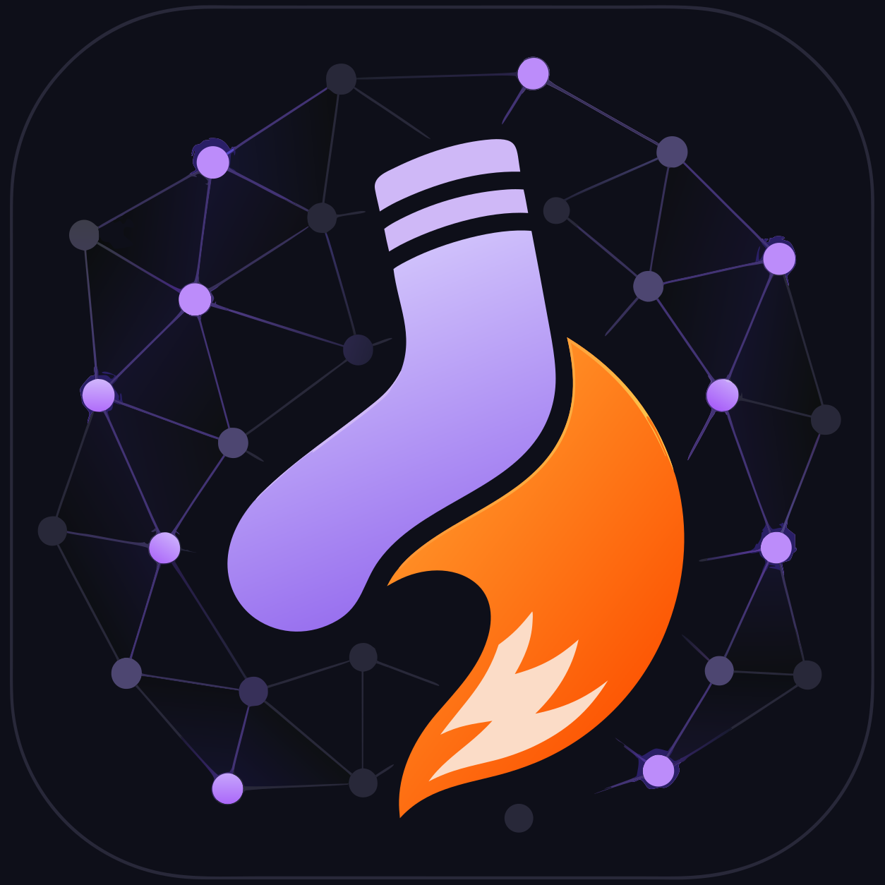
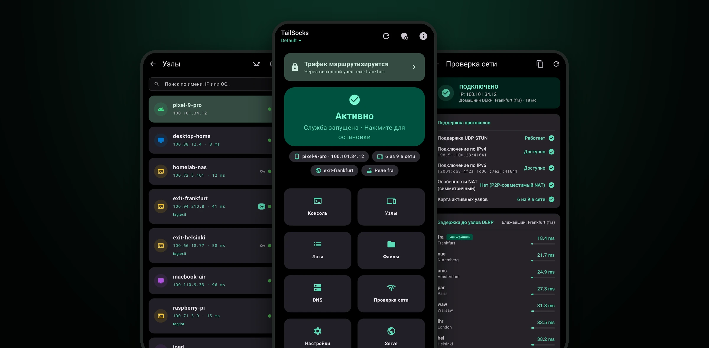
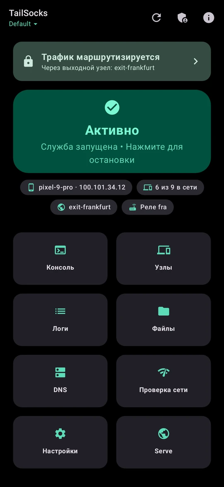
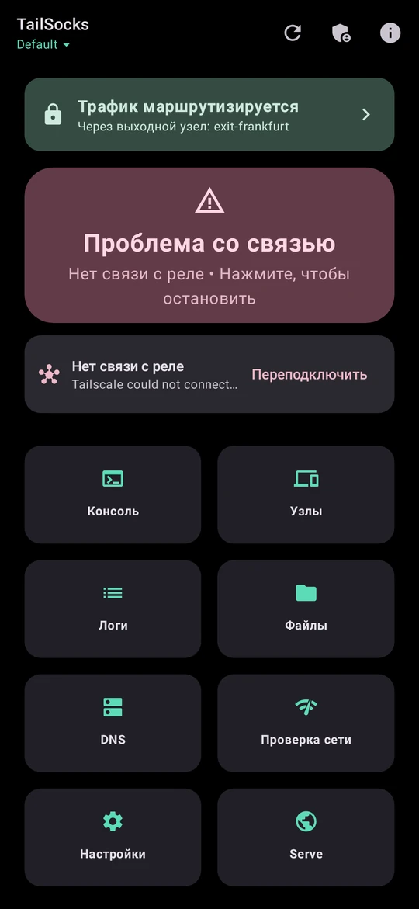
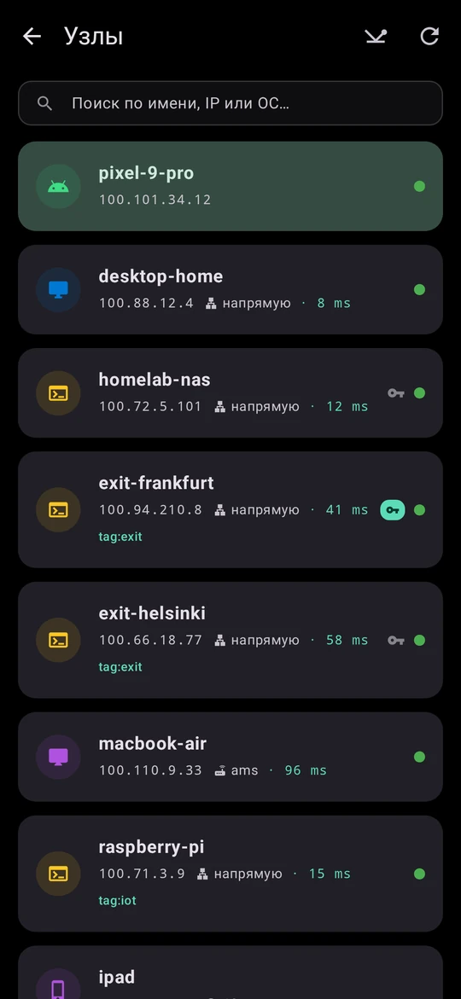
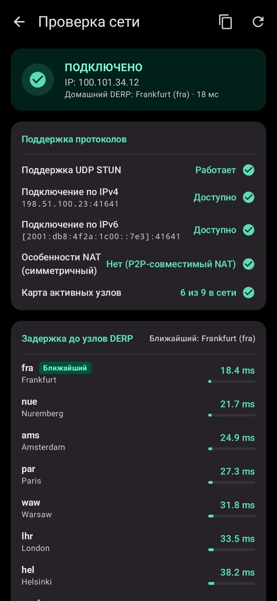
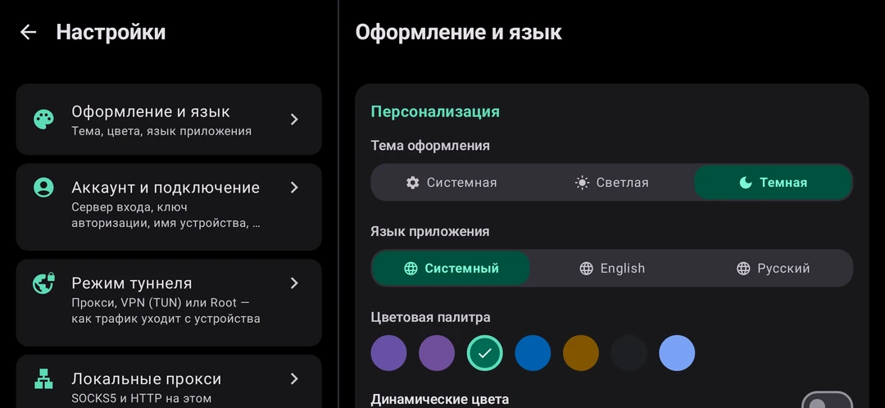
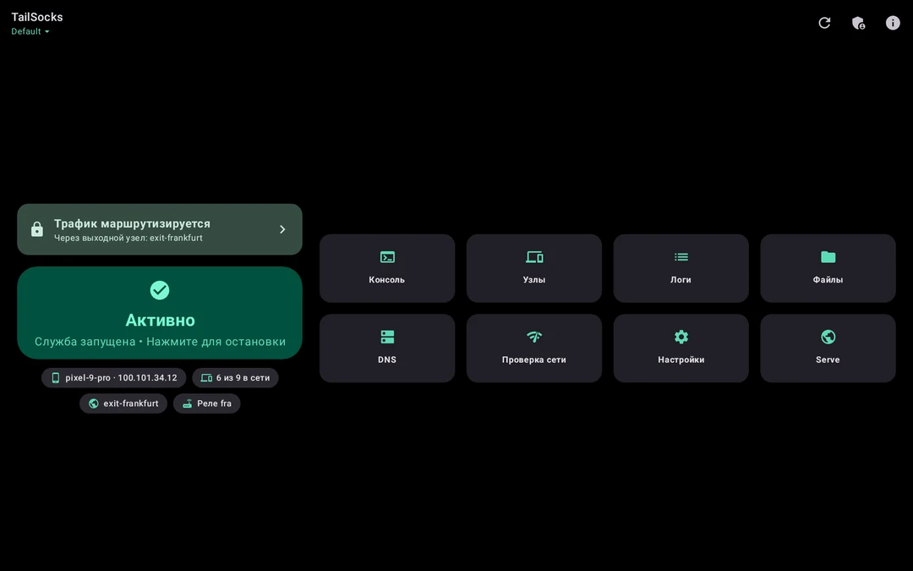

  

<h1 align="center">TailSocks</h1>

  <strong>Неофициальный клиент Tailscale для Android — прокси, VPN или root-маршрутизация</strong>

  <a href="readme.md">English</a> | <strong>Русский</strong>

<table align="center">
  <tr>
    <th>Релиз</th>
    <th>Загрузки</th>
    <th>Ядро Tailscale</th>
    <th>Лицензия</th>
    <th>Перевод</th>
  </tr>
  <tr>
    <td align="center"></td>
    <td align="center"></td>
    <td align="center"></td>
    <td align="center"></td>
    <td align="center"></td>
  </tr>
</table>

<table align="center">
  <tr>
    <td align="center"></td>
    <td align="center"></td>
  </tr>
  <tr>
    <td align="center"></td>
    <td align="center"></td>
  </tr>
</table>

  

  <a href="https://bropines.github.io/tailsocks/ru/"><strong>📖 Руководство: bropines.github.io/tailsocks</strong></a> 
  Установка, режимы подключения, файлы, обход блокировок, автоматизация, решение проблем

---

TailSocks запускает на Android-телефоне (экспериментально — и на Android TV) полноценный узел [Tailscale](https://tailscale.com/) и даёт выбрать, как он доступен остальному устройству: как **локальный SOCKS5/HTTP-прокси**, которому не нужно разрешение VPN и который уживается с любым другим VPN; как **системный VPN** (TUN, раздельный или полный туннель); или — на рутованных устройствах — через **настоящий сетевой интерфейс ядра** с policy routing. Всё, что умеет Tailscale, на месте: [выходные узлы](https://tailscale.com/kb/1103/exit-nodes), [MagicDNS](https://tailscale.com/kb/1081/magicdns), [Taildrop™](https://tailscale.com/kb/1106/taildrop), [Taildrive™](https://tailscale.com/kb/1369/taildrive), [Serve & Funnel](https://tailscale.com/kb/1242/tailscale-serve), несколько аккаунтов, Headscale и встроенный обход DPI для управляющего канала там, где Tailscale блокируют.

Приложение говорит, что происходит на самом деле: подключён ли тейлнет, ещё подключается или отрезан от реле, какие ваши устройства доступны напрямую, а какие только через реле, — и предлагает то единственное действие, которое поможет.

---

## ✨ Возможности

**Подключение** — [режимы подключения](https://bropines.github.io/tailsocks/ru/connection-modes/)

- **Три режима:** локальный SOCKS5/HTTP-прокси без разрешения VPN, системный VPN (TUN) или Root-режим на настоящем `tailscale0` (экспериментально).
- **Выходные узлы, MagicDNS, split DNS** и принятые маршруты подсетей; прокси можно открыть для своего Wi-Fi.
- **Обход блокировок:** встроенный ByeDPI, прокси для Control Plane, порт 443 для канала управления, запуск по сохранённой карте сети — [подробнее](https://bropines.github.io/tailsocks/ru/censorship/).

**Файлы и сервисы**

- **Taildrop:** отправка из меню «Поделиться» любого приложения, приём в выбранную папку — [файлы](https://bropines.github.io/tailsocks/ru/files/).
- **Taildrive:** общие папки, обзор папок других устройств, воспроизведение их файлов с перемоткой.
- **Serve & Funnel** и сервисы Tailscale (`svc:`), с экспортом TLS-сертификатов.

**Управление**

- **Несколько аккаунтов**, Headscale и основной аккаунт, который нельзя удалить.
- **Удалённое управление (экспериментально):** управлять TailSocks другого устройства через тейлнет после сопряжения по коду.
- **Консоль администратора:** API Tailscale — устройства, DNS, пользователи, ключи, политика — под биометрической защитой.
- **Автоматизация:** broadcast-команды для Tasker с токеном, AppFunctions для ассистентов на Android 16+, ссылки `tailsocks://` — [автоматизация](https://bropines.github.io/tailsocks/ru/automation/).
- **Резервные копии:** полный зашифрованный бэкап и экспорт отдельных аккаунтов.

**В работе**

- **Честный главный экран:** что не так — и то действие, которое поможет.
- **Android TV (экспериментально):** тот же APK, всё приложение с пульта, вход по QR-коду.
- **Поиск по настройкам** по-русски и по-английски, с опечатками и в неверной раскладке.
- **Material 3:** темы и динамические цвета, две панели на планшетах и раскладушках, виджеты, плитка быстрых настроек.
- **Перевод** на [Hosted Weblate](https://hosted.weblate.org/engage/tailsocks/).

---

## 📸 Скриншоты

<table>
  <tr>
    <td width="25%" align="center"> Подключено, со сводкой тейлнета</td>
    <td width="25%" align="center"> Что не так — и что поможет</td>
    <td width="25%" align="center"> Узлы с пингом всех разом</td>
    <td width="25%" align="center"> Домашнее реле и задержки DERP</td>
  </tr>
  <tr>
    <td colspan="2" align="center"> Настройки в две панели на широком экране</td>
    <td colspan="2" align="center"> Планшеты и раскладушки — две панели</td>
  </tr>
</table>

Отрисовано из вымышленного тейлнета собственными превью-тестами приложения — см. <a href="scripts/readme_shots.py"><code>scripts/readme_shots.py</code></a>.

---

## 🚀 Скачать

APK — на странице [релизов](https://github.com/bropines/tailsocks/releases/latest), или добавьте репозиторий в [Obtainium](https://apps.obtainium.imranr.dev/redirect?r=obtainium://add/https://github.com/bropines/tailsocks). Тот же APK ставится на Android TV. Первые шаги — в [начале работы](https://bropines.github.io/tailsocks/ru/getting-started/).

Бета-версии следующего релиза выходят на GitHub как pre-release: приложение предлагает их, если включить «Получать бета-версии» (Настройки → Оформление и язык), Obtainium — если включить у него *Include prereleases*.

> **Поддерживаемые архитектуры:** `arm64-v8a`, `armeabi-v7a`, `x86`, `x86_64`  
> **Минимальная версия Android:** 7.0 (API 24)

---

## 📚 Документация

**Как пользоваться:** [bropines.github.io/tailsocks/ru](https://bropines.github.io/tailsocks/ru/).

**Для разработчиков:** [Сборка](docs/BUILDING_RU.md) · [Архитектура](docs/ARCHITECTURE_RU.md) · [Root](docs/ROOT_RU.md) · [Serve & Funnel](docs/SERVE_FUNNEL_GUIDE_RU.md) · [Участие в разработке](CONTRIBUTING_RU.md) · [Перевод](docs/TRANSLATING_RU.md) · [Планы](docs/ROADMAP_RU.md) · [История изменений](CHANGELOG.md)

---

## 🤝 Благодарности

| | |
|-|-|
| **Приложение и Патчи** | [Bropines](https://github.com/bropines) — разработка приложения, архитектура и большинство патчей ядра |
| **Первичные Android-патчи** | [Asutorufa](https://github.com/Asutorufa) — оригинальные [патчи](https://github.com/Asutorufa/tailscale) сети (`anet`) и мониторинга (`netmon`), послужившие отправной точкой |
| **Обход DPI** | [hufrea/byedpi](https://github.com/hufrea/byedpi) — утилита обхода DPI через локальный HTTP/SOCKS5 прокси |
| **TUN Движок (совместимость)** | [heiher/hev-socks5-tunnel](https://github.com/heiher/hev-socks5-tunnel) — нативная библиотека трансляции SOCKS5 в TUN-интерфейс |
| **Ядро Tailscale** | [Tailscale Inc.](https://github.com/tailscale/tailscale) — сетевой движок в пользовательском пространстве (`tsnet`) |
| **ИИ Помощник** | [Google Gemini](https://gemini.google.com/) — разработка интерфейса, исследование LocalAPI и проектирование патчей |
| **ИИ Помощник** | [Claude](https://claude.com/claude-code) от Anthropic, в Claude Code — исправления демона и моста (вход, реакция на смену сети, падения на Android 10), адаптивная вёрстка, скриншоты-превью без устройства и исследование каналов распространения |

---

## 📜 Лицензия

Распространяется под лицензией **BSD 3-Clause License**. Смотрите [`LICENSE`](LICENSE) для подробностей.

*Tailscale, Taildrop, Taildrive, MagicDNS и Funnel являются товарными знаками Tailscale Inc. Этот проект является независимой разработкой с открытым исходным кодом и не связан с Tailscale Inc.*
